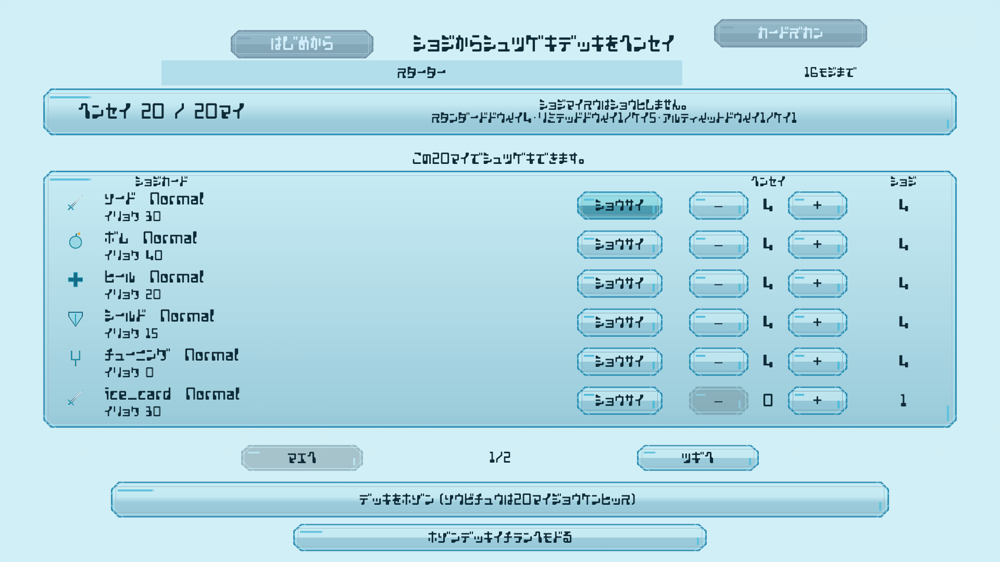
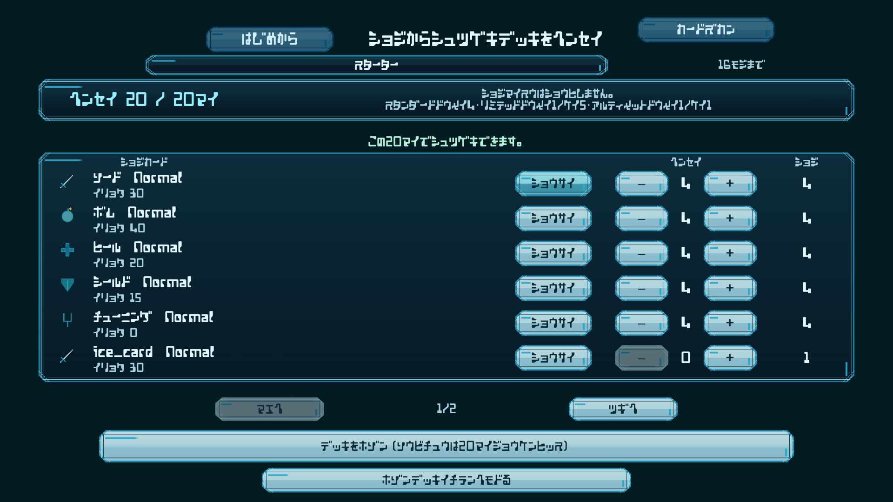

# Stage85〜96 統合検証・差分整理

基準: `ea75e94e7e94d30e8068288fa466312a912e85c9`。製品変更は7 C#（うちテスト2）と既存Prefab1、説明更新2ファイル。ゲーム計算・保存形式・入力割当・60 Hz契約を追加変更しない。

| 段階 | 目的 / 変更ファイル | 依存と段階別検証 |
|---|---|---|
| 85 | `ExplorationResumeCountdown.cs` の巡回入力状態名・時刻群処理を分割 | 挙動不変。関連786 / 反復30 / 全3821成功 |
| 90 | `HandCardView.cs` / `CardEffectView.cs` のprivate reflectionを型付き初期化へ | `CustomScreenCostViewTests.cs`。Awake前後・捕捉一回。関連423実行 / 反復16 / 全3822成功 |
| 92 | `DungeonBattleController.cs` のスタイル選択中の補助ボタン表示・旧入力遮断 | `DungeonBattleManagerTests.cs`。関連1106実行 / 反復2 / 全3823成功 |
| 93/94 | `CardSelectionView.cs` の通常保存一覧・編成の読み面を既存素材で統一、一覧のページ操作との間隔を維持 | 94は93の共通処理を拡張。CustomScreenテストは90と同一ファイル。各最終関連6/389/95/30、反復12成功。全件は下記統合で再実行 |
| 96 | `DungeonHud.prefab` の操作案内を既存JikiTouraiへ、Integrationテストで参照保証 | Prefabのフォント参照1行のみ。関連1/2/95、反復6成功。全件は下記統合で再実行 |
| 87 / 説明整理 | `Planning/未決仕様引継ぎ.md` のS09実装済みと未実装を区別、`.Codex/tools/README.md` の関連hash包含条件を正確化 | ゲート実装・製品仕様の変更なし |

テストファイルと共通表示処理に段階間の重なりがあるため、最終の合成バイトを一つの検証単位として扱う。Stage86/88/89/91/95は読取・実操作確認で製品差分なし。

## 代表画面

既存の通常デッキ編成の実入口。比較はFHDの同じ画面状態。入力領域・保存・編成契約を保持し、既存背景・JikiTourai・水鏡素材を使用。

| 変更前 | 変更後 |
|---|---|
|  |  |

比較画像はこの一組に絞る。その他の各段階の画像と原始検証結果は検証環境の既存証跡で保持し、新たな重複撮影を行わない。

## 統合検証

最終全3823件成功（235.57秒、失敗・スキップ0）、最終関連1013実行成功（font1 / guide2 / Custom389 / Integration621）。公開ゲート単体18件成功。全件の180秒wrapper timeout後は同じ実行の結果を回収し、再投入しなかった。

実描画640×360（Screenと両RT）、専用TMPDIR/saveguard、元プロジェクトclean、保存4系統・既存証跡43件のSHA保持を確認。検証mirrorとの928資産比較は既知private URP2件を除き差分0。生成資源・EventSystem・論理時計所有と注入fixtureの残留なし。全件の生ログ警告59件は既存の欠損UI/不正phase/空deck/不正設定/pool上限経路として分類し、累積117・表示バッファ43とは区別する。エラー0。

最終結果は同梱の `full-tests.json` / `related-tests.json` / `cleanup.json` / `independent-review.json` / `final-source-hashes.json` を参照。段階別成功を最終全件成功の代用にしない。

## 限界・未実装

S09のカード使用割当、S10の製品デッキ接続、S11/12等の未決仕様は決定しない。旧Scene直起動のフォントを含め全画面の統一完了とはしない。製品ビルド・物理入力・聴感・全HotReloadは未確認。歴史的UGUI/Pipeline/CLI/UnityAI、登録外Sprite基準群と各段階の初回失敗・回復履歴は解決済み扱いにしない。
